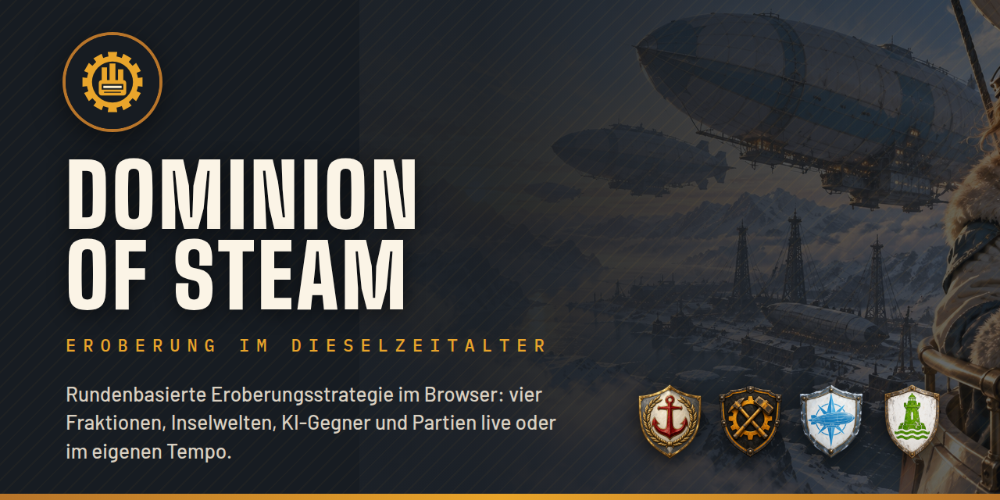

# Dominion of Steam



Rundenbasierte Eroberungsstrategie in einer alternativen Dieselpunk-Welt. Du baust in deinen Städten Panzerwagen, Luftschiffe und Kriegsschiffe, erkundest die Karte im Kriegsnebel und eroberst Stadt um Stadt, gegen Freunde oder gegen die KI. Das Spiel läuft komplett im Browser, auf dem Desktop wie auf dem Smartphone.

## Merkmale

- **Vier Fraktionen** (Aurelia, Eisenbund, Nordmark, Salzküsten-Liga) mit eigenen Stärken und Sondereinheiten
- **Land, See und Luft:** Kampf mit Trefferpunkten, Gelände- und Stadtboni, Transporte über See, Flugzeugträger, getarnte Tauchboote
- **Prozedurale Karten** von 20×20 bis 200×200 Feldern, als Kontinent, Inselwelt oder Archipel
- **Live oder asynchron:** Partien in einer Sitzung oder über Tage verteilt, mit Zugfristen sowie Push- und E-Mail-Benachrichtigungen
- **KI-Gegner** in drei Stufen und mit eigenen Persönlichkeiten, abgestimmt in simulierten Partien KI gegen KI
- **Eigene Klangwelt:** adaptive Musik, die sich der Lage auf dem Spielfeld anpasst

## Selbst ausprobieren

Voraussetzung ist Docker:

```bash
docker compose up -d --build   # Postgres, Mailpit und das Spiel auf http://localhost:8080
```

Lokal legt der Server Testkonten und eine Demo-Partie an, etwa `bjoern@dominion.test` mit dem Passwort `dampfmaschine`. Entwicklung mit Hot Reload, Aufbau des Codes, Tests und Spielregeln im Detail: [docs/ENTWICKLUNG.md](docs/ENTWICKLUNG.md). Betrieb auf einem eigenen Server: [deploy/README.md](deploy/README.md).

## Technik

TypeScript im Monorepo: React, Vite und Tailwind CSS im Browser, Fastify und PostgreSQL (Drizzle) auf dem Server, eine gemeinsame Regel-Engine und KI in `packages/shared`, dazu eine Headless-Simulation für KI-Balance in `packages/sim`.

## Lizenz

Der Quellcode steht unter der [MIT-Lizenz](LICENSE). Ausgenommen sind Illustrationen, Wappen, Musik und das Titelbild; die Soundeffekte stammen aus CC0-Aufnahmen. Einzelheiten stehen in [LICENSE](LICENSE).
